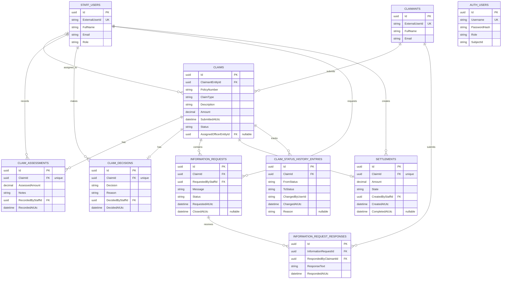

# Claim Service System database diagram

The diagram below reflects the entity model and relationships configured in `ClaimsDbContext`.

## Relationship and delete behavior notes

- A `CLAIMANT` can submit many `CLAIMS`; each claim has exactly one claimant.
- A `STAFF_USER` can be assigned many claims; the assignment is optional on a claim.
- A claim can have many assessments and status-history records, but at most one decision and one settlement.
- An information request belongs to one claim and can have many responses. Responses identify the claimant who submitted them.
- Staff references use restricted deletes. Claim-owned records use cascade deletes.
- `AuthUser` is intentionally shown without relationships because the current EF Core model does not define foreign keys to the claimant or staff tables.
- Enum properties are stored as strings by the EF Core configuration: `ClaimStatus`, `StaffRole`, `ClaimDecisionType`, `InformationRequestStatus`, and `SettlementState`.
- `UK` marks unique indexes. `FK` marks foreign keys. `nullable` marks optional columns.
